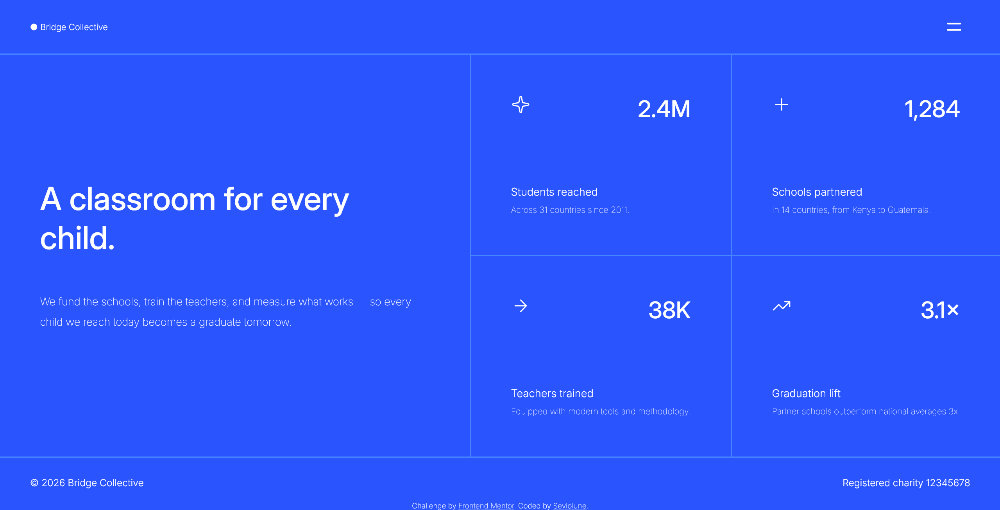

# Frontend Mentor - Grid landing page solution

This is a solution to the [Grid landing page challenge on Frontend Mentor](https://www.frontendmentor.io/challenges/grid-landing-page).

Feel free to tell me anything I could improve on.

## Overview

### The challenge

Users should be able to:

- View the optimal layout for the page depending on their device's screen size
- See hover and focus states for all interactive elements on the page
- Open and close the navigation menu at any screen size (optional JavaScript)

### Screenshot

### Links

- Solution URL: [https://www.frontendmentor.io/solutions/animated-and-responsive-grid-landing-page-with-html-css-and-js-YItIuA7v_k](https://www.frontendmentor.io/solutions/animated-and-responsive-grid-landing-page-with-html-css-and-js-YItIuA7v_k)
- Live Site URL: [https://seviolune.github.io/grid-landing-page-main](https://seviolune.github.io/grid-landing-page-main)

## Author

- Github [Seviolune](https://github.com/Seviolune)
- Frontend Mentor [@Seviolune](https://www.frontendmentor.io/profile/seviolune)